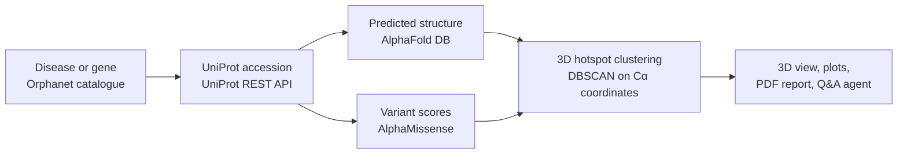

# Rare-Disease Protein Impact Explorer 🧬

> 🥉 **3rd Place, AI Hackathon at the India AI Impact Summit 2026**, built in a four-person team.
> This is my fork of the team repository, [Moinuddin-Hasan/Rare-Disease-Protein-Impact-Explorer](https://github.com/Moinuddin-Hasan/Rare-Disease-Protein-Impact-Explorer).

Pick a rare disease or type a gene, and the app shows where the dangerous mutations sit on the protein's 3D structure, and which of them cluster together in space.

Pathogenicity scores such as AlphaMissense rate one variant at a time, along the sequence. Two residues that are 200 positions apart in the sequence can still touch once the protein folds. The app puts each residue's AlphaMissense score onto its AlphaFold structure and clusters the high-risk residues by 3D distance. That surfaces **structural hotspots** that a sequence-only view misses.

## How it works



1. **Disease → gene.** The Orphanet rare-disease catalogue maps each disorder to its primary gene, and the reverse. A gene symbol or UniProt accession can also be typed directly.
2. **Gene → protein.** The UniProt REST API resolves the human gene to its accession.
3. **Structure.** The predicted model is downloaded from the AlphaFold DB, along with its per-residue confidence (pLDDT).
4. **Variant risk.** AlphaMissense scores for that protein are streamed in chunks out of the 600 MB+ genome-wide file, then cached per protein so a second lookup is instant.
5. **Hotspots.** Residues with an AlphaMissense score above 0.6 are placed at their Cα coordinates and clustered with DBSCAN (10 Å radius, at least 3 residues). Each cluster is a group of high-risk residues that are close together in the folded protein.

## What you see

- **Interactive 3D structure** (Mol\* and py3Dmol) with toggleable layers: hotspot overlay, AlphaMissense risk, Kyte-Doolittle hydrophobicity, secondary structure and pLDDT confidence bands.
- **Instability plot**: AlphaMissense score along the sequence, so peaks line up with residue positions.
- **Model confidence plot**: pLDDT per residue, so low-confidence regions aren't over-read.
- **Summary and export**: mean pathogenicity, number of hotspot clusters and a status band, downloadable as JSON or as a PDF report with the plots.
- **Ask the agent**: a Groq-hosted Llama 3.1 assistant that answers questions about the current protein, using the analysis on screen and a small knowledge base as context. Optional: it needs a `GROQ_API_KEY`.

## Run it locally

```bash
git clone https://github.com/aaditripi18/Rare-Disease-Protein-Impact-Explorer.git
cd Rare-Disease-Protein-Impact-Explorer
pip install -r requirements.txt
```

The two large data files are not in the repository. Download them first:

| File | Put it at | Source |
|---|---|---|
| `AlphaMissense_hg38.tsv.gz` | `data/raw/` | [AlphaMissense predictions](https://zenodo.org/records/8208688) |
| `en_product6.xml` (genes associated with rare disorders) | `data/references/` | [Orphadata](https://www.orphadata.com/genes/) |

```bash
streamlit run app.py
```

## Tech stack

Python · Streamlit · Biopython · scikit-learn (DBSCAN) · pandas · Altair · Mol\* / py3Dmol · FPDF · Groq API.
Data: Orphanet · UniProt · AlphaFold DB · AlphaMissense.

## Team

- Moinuddin Hasan Raichur Mohammed
- Aaditya Tripathi
- Aditya Sridhar
- Goureesankar S Nair

### My contribution

- **ML analysis.** Worked with the team on the machine-learning side: mapping AlphaMissense pathogenicity predictions onto AlphaFold structures, and the DBSCAN clustering that finds 3D mutation hotspots (risk cutoff, cluster radius and minimum cluster size).
- **Data pipeline.** Worked on the Python backend that links Orphanet, UniProt, AlphaFold DB and AlphaMissense, including chunked reading and per-protein caching of the large AlphaMissense file.
- **Design and pitch.** Co-designed the solution and presented it to the judges.

## Limitations

- AlphaFold structures and AlphaMissense scores are **predictions**, not experimental data. Hotspots inside low-pLDDT regions should be treated with caution.
- The 0.6 risk cutoff and the DBSCAN settings were chosen during the hackathon. They have not been tuned or validated against clinical labels such as ClinVar.
- For research and education only. Not for clinical diagnosis.
